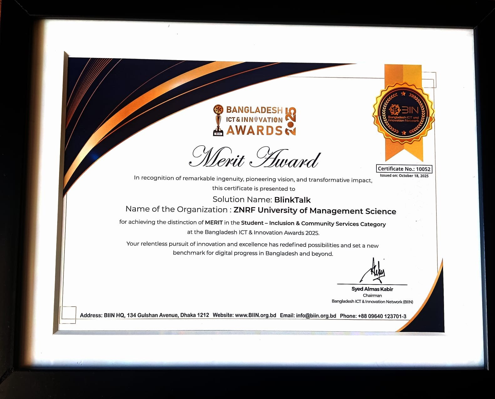

# Merit Award — Bangladesh ICT & Innovation Awards 2025

| | |
|---|---|
| **Award** | Merit, Student — Inclusion & Community Services category |
| **Project** | BlinkTalk |
| **Organization** | ZNRF University of Management Sciences (ZUMS) |
| **Issued by** | Bangladesh ICT & Innovation Network (BIIN) |
| **Certificate no.** | 10052 |
| **Issued on** | 18 October 2025 |

BlinkTalk is a health-tech solution that helps paralyzed patients communicate using eye blinks. It received a Merit distinction in the Student — Inclusion & Community Services category at the Bangladesh ICT & Innovation Awards 2025. The award was also covered in the press (Dhaka Mail).

## Certificate

## Media coverage

[← Back to all achievements](../../README.md)
