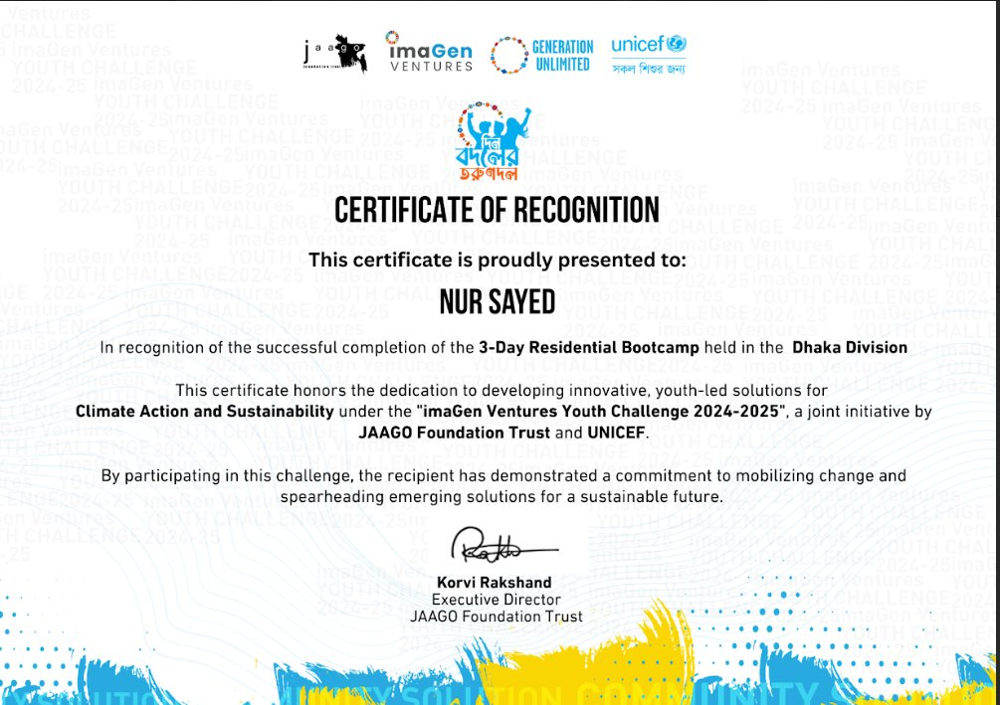
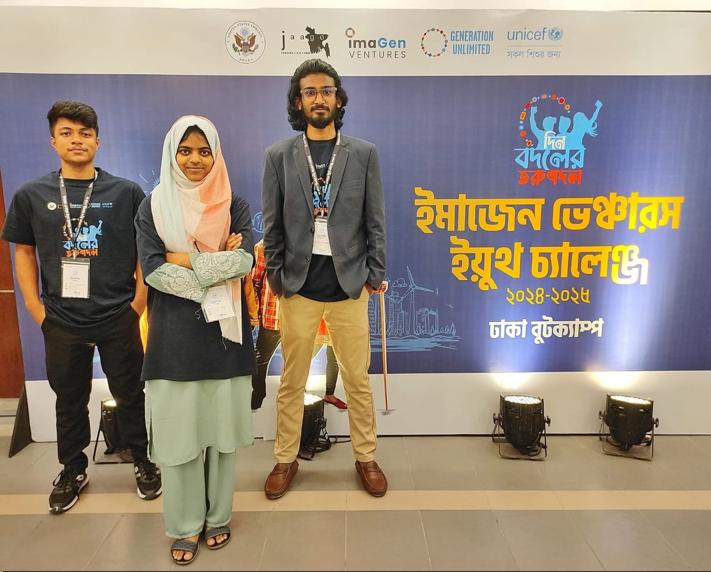

# imaGen Ventures Youth Challenge 2024–2025 — Divisional Champion

| | |
|---|---|
| **Result** | Divisional Champion, Dhaka Division |
| **Project** | AirAQI |
| **Track** | Climate Action and Sustainability |
| **Organized by** | imaGen Ventures; a joint initiative of JAAGO Foundation Trust and UNICEF |
| **Year** | 2024–2025 |

AirAQI, an IoT air-quality monitoring platform, became Divisional Champion for Dhaka Division in the imaGen Ventures Youth Challenge 2024–2025. The Certificate of Recognition was given for completing the 3-day residential bootcamp in Dhaka Division.

## Certificate

## Photo

[← Back to all achievements](../../README.md)
