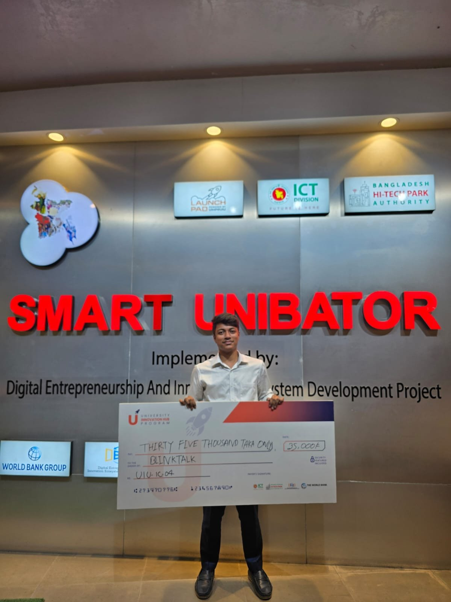
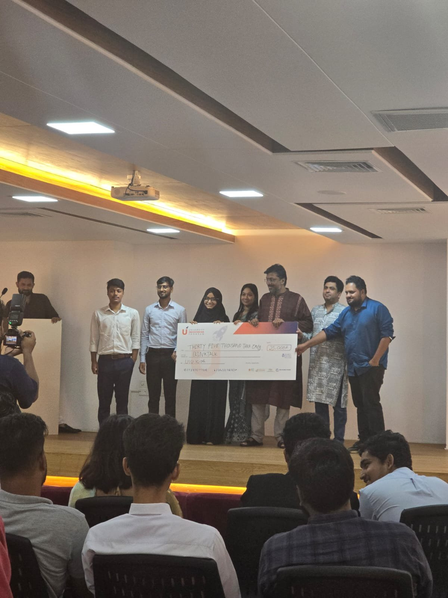

# University Innovation Hub Program Grant — BlinkTalk

| | |
|---|---|
| **Amount** | BDT 35,000 |
| **Project** | BlinkTalk |
| **Reference** | UIU-IC-04 |
| **Issued by** | University Innovation Hub Program (UIHP) |
| **Year** | 2025 |

The UIHP awarded BlinkTalk a BDT 35,000 innovation grant. UIHP runs under the Digital Entrepreneurship and Innovation Ecosystem Development (DEIED) Project. The cheque was handed over at the Smart Unibator.

## Photos

[← Back to all achievements](../../README.md)
