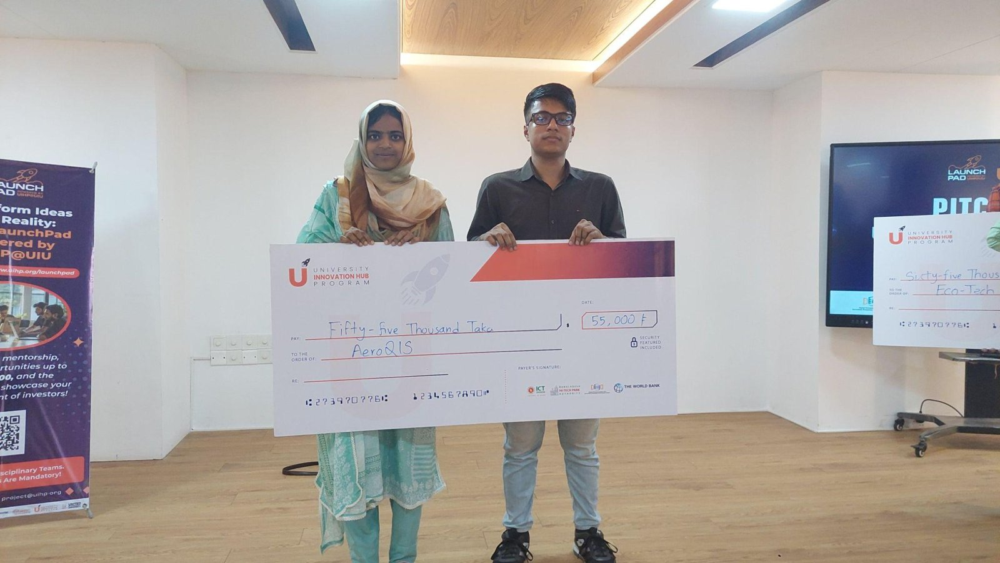

# UIHP LaunchPad Grant — AirAQI

| | |
|---|---|
| **Amount** | BDT 55,000 |
| **Project** | AirAQI (team name on cheque: AeroQIS) |
| **Program** | LaunchPad, powered by UIHP @ UIU |
| **Issued by** | University Innovation Hub Program (UIHP) |
| **Year** | 2025 |

AirAQI, an IoT air-quality monitoring platform, received a BDT 55,000 grant at the UIHP LaunchPad pitch at United International University (UIU).

## Photo

[← Back to all achievements](../../README.md)
