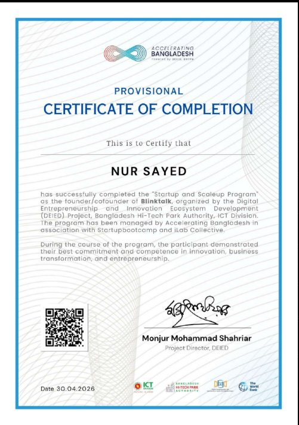

# Startup and Scaleup Program — Certificate of Completion

| | |
|---|---|
| **Certificate** | Provisional Certificate of Completion |
| **Role** | Founder / co-founder of BlinkTalk |
| **Organized by** | Digital Entrepreneurship and Innovation Ecosystem Development (DEIED) Project, Bangladesh Hi-Tech Park Authority, ICT Division |
| **Managed by** | Accelerating Bangladesh, with Startupbootcamp and iLab Collective |
| **Date** | 30 April 2026 |

I completed the Startup and Scaleup Program as founder / co-founder of BlinkTalk. The program covered innovation, business transformation and entrepreneurship.

## Certificate

[← Back to all achievements](../../README.md)
